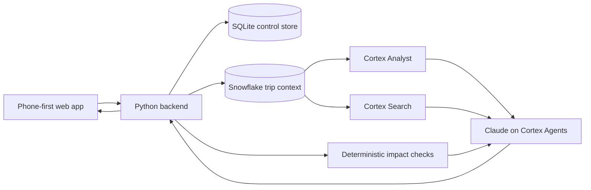

# Wayfinder

Wayfinder is a phone-first travel agent that turns scattered booking documents into one living itinerary. It maps every stop, watches the journey for changes, explains downstream effects, and gives the traveler a small set of grounded choices instead of another search task.

Built for the Intelligence at Work hackathon with **Snowflake Cortex**, **Claude**, and **CoCo**.

**[Watch the 52-second product demo](demo/output/wayfinder-demo.mp4)**

**[Watch the 25-second recovery-choice demo](demo/output/wayfinder-recovery-demo.mp4)**

**[Watch the 57-second combined Short](demo/output/wayfinder-combined-short.mp4)**

## Demo flow

The included Chile scenario is synthetic and uses sanitized references:

1. Create an itinerary by uploading the five files in `data/chile-documents/`.
2. Review the complete, on-time journey from San Francisco through Santiago, Atacama, Puerto Natales, and Torres del Paine.
3. Open any stop to see its saved source document, map, and relevant commute options.
4. Trigger the labeled 71-minute delay replay. Wayfinder updates the inbound flight and identifies the tighter Santiago connection and affected downstream plans.
5. Ask the agent to summarize the trip or explain what changed. The answer is grounded in the unified itinerary and reviewed evidence.

The repository fixtures contain no real traveler identity, account credentials, or usable booking locators.

The second, fictional London scenario focuses on the approval boundary. A two-hour delay breaks the original train connection; the traveler chooses the recommended later train and confirms once. The backend records that decision, marks the original connection missed, promotes the replacement as the active journey, updates the hotel arrival and reminders, and exposes the change in the itinerary and audit history. No provider booking or payment occurs.

## How it works



Snowflake holds the reviewed itinerary, document evidence, and current recovery state. Cortex Search retrieves supporting text, Cortex Analyst reads structured trip facts, and Claude explains relationships and available decisions. Deterministic Python checks remain authoritative for timing, feasibility, and approval state.

## Features

- Create and manage multiple itineraries from up to 15 TXT or text-based PDF documents.
- Review extracted facts before they become answerable evidence.
- Combine flights, ground transport, lodging, tours, and traveler-added plans in one timeline.
- Open itinerary items for maps, commute options, and linked source documents.
- Monitor a configured flight provider while the app is open, with a deterministic replay for a reliable demo.
- Propagate a flight change to downstream commitments and surface clear notifications.
- Ask concise trip questions through a Snowflake-backed Claude agent.
- Keep passport evidence local and out of the Snowflake retrieval path.
- Simulate recovery approval without purchasing, canceling, charging, or filing a claim.

## Run locally

Requirements: Python 3.12 and a modern browser.

```sh
python3.12 -m venv .venv
.venv/bin/pip install -r requirements.txt
cp .env.example .env.local
./scripts/run.sh
```

Open <http://127.0.0.1:8765>.

All integrations are optional. Without credentials, the local grounded workflow and labeled delay replay remain available. To enable integrations, add values only to the ignored `.env.local` file:

- `SNOWFLAKE_CONNECTIONS_FILE` and `SNOWFLAKE_CONNECTION_NAME` for the hackathon Snowflake account
- `AVIATIONSTACK_API_KEY` for read-only flight status checks
- `GOOGLE_ROUTES_API_KEY` for server-side live routing
- `GOOGLE_MAPS_BROWSER_KEY` for the interactive map

Restrict browser and server keys to the required APIs, origins, and hosts. Never commit `.env.local`, Snowflake connection files, runtime databases, traveler uploads, or raw recordings.

## Snowflake setup

The provisioning script creates an isolated `WAYFINDER_POC` schema containing runtime tables, a semantic view, Cortex Search, and a Cortex Agent configured for Claude:

```sh
.venv/bin/python scripts/provision_snowflake.py
```

The script reads credentials from the ignored Snowflake CLI connection file. Review `sql/001_core.sql` and account privileges before provisioning.

## Verify

```sh
PYTHONPATH=src .venv/bin/python -m unittest discover -s tests -v
.venv/bin/python -m py_compile src/travel_recovery/*.py scripts/provision_snowflake.py
node --check web/app.js
```

## POC boundaries

Wayfinder is a single-traveler hackathon prototype. Flight monitoring runs while the app is open. The replay, availability, prices, rewards, boarding pass, and benefit policy are demo data. Check-in and recovery actions mutate local demo state only. The app does not perform airline check-in, booking, cancellation, payment, background push delivery, claim filing, OCR, immigration advice, or production multi-user isolation.

See [architecture.md](architecture.md) for the trust boundaries and [review.md](review.md) for the remaining production gates.
