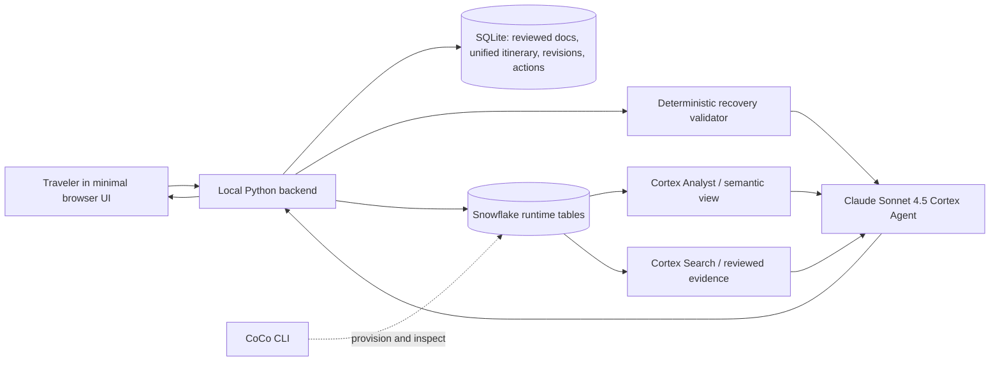
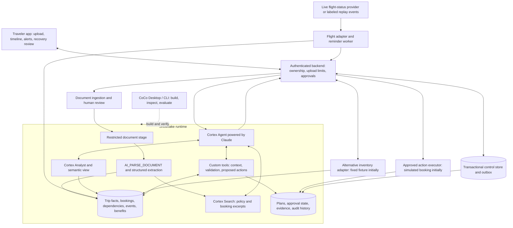

# Travel Recovery Agent — Architecture and POC

## Goal

Help a traveler manage an already-booked journey without manually reconstructing it after a disruption. Up to 15 uploaded documents plus personal plans entered by chat or voice become one connected itinerary. The agent monitors flights, identifies effects on bookings and commitments, proposes feasible recovery options, and prepares a conditional reimbursement checklist with source evidence.

POC success: one delayed flight causes a missed train and threatens an arrival-night activity while later plans remain safe. The system rejects a cheap bus that misses hotel check-in, proposes valid alternatives, and gives the traveler one clear choice. Benefit advice never treats possible reimbursement as guaranteed money. This first vertical slice supports delays only. Cancellations, uncertain arrival times, and independent hotel/transport disruptions require additional event types and acceptance cases before they are advertised as supported.

## Current implementation versus target

Implemented now: a phone-oriented browser UI and stdlib Python HTTP backend, a two-path itinerary creation screen (sample inbox or document upload), transactional SQLite state, TXT/text-PDF ingestion with explicit review, a 15-document cap, traveler commitments captured by text or browser speech, deterministic commitment-impact and recovery validation, simulated inventory/actions, rewards/passport snapshot panels, a backend-only Google Routes adapter, and 59 local tests. Reviewed non-identity evidence, structured trip facts, commitments, their impact labels, and the validated recovery are synchronized per question to `DEFAULT_DATABASE.WAYFINDER_POC`. A managed Claude Sonnet 4.5 Cortex Agent uses Cortex Analyst and Search to explain that context; deterministic code remains authoritative for timing and feasibility. CoCo and the Snowflake account are verified.

The bounded demo is one local traveler, one synthetic flight/train/hotel chain, traveler-added destination plans, delay events, and one currency. Its email entry path imports a fictional sample inbox; production Gmail or Outlook access requires provider OAuth, message-scope review, extraction, deduplication, and deletion controls. A configured read-only Aviationstack adapter checks real flight itineraries while the app is open; a labeled replay drives the repeatable `DEMO` flight. It surfaces in-app disruption/reminder notifications and can show opt-in browser alerts while open. There is no durable background worker, OCR, cancellation recovery, real rebooking/payment, claim submission, durable notification delivery, or multi-user isolation.

The traveler can open a flight row to see check-in state, a sample boarding pass, leave guidance, status, and downstream effects. Check-in is a local demo mutation and the pass is deliberately non-scannable. The traveler can open a train row to see reviewed ticket details, the flight-derived connection state, station guidance, and walk, bus, and taxi estimates from the arrival station. The POC has no live rail, maps, traffic, or ground-pricing adapter, so those fields retain explicit provenance and assumptions instead of presenting estimates as live facts.

Known public destinations in the London fixture receive a bounded place guide. Resolution considers the itinerary title and location together because confirmations often put the precise venue in the title and only a neighborhood in the address field (for example, `London Eye tickets` at `South Bank`). Every resolved commitment keeps the resolver query and matched alias as provenance. When a traveler explicitly grants browser location access, the browser sends current latitude/longitude plus a commitment ID to the backend. The backend resolves the destination from the server-owned itinerary, calls Google Routes with a backend-only key, and returns distance, duration, travel mode, and encoded route geometry. Driving uses traffic-aware routing; walking and transit use Google's current route result. Current coordinates are not saved to the itinerary. Without permission, credentials, or a provider response, the existing clearly labeled fixture estimate remains visible. Unknown destinations remain unplotted rather than receiving invented coordinates. A general uploaded itinerary still needs a governed geocoder after extraction, with ambiguous matches sent to the traveler for confirmation; the configured Google project currently has Maps JavaScript and Routes enabled but not Geocoding. Production also needs provider quota monitoring, retention policy, accessibility constraints, and tests on deployed HTTPS location permission behavior.

### Implemented POC data path



## Implementation decisions and trust boundaries

- Backend: one stdlib Python HTTP process; the browser uses HTML/CSS/JavaScript without a frontend framework. The deterministic validator runs in Python and remains authoritative for feasibility. It has not been packaged as a Snowflake procedure.
- Operational control: SQLite transactions and uniqueness constraints enforce document count/deduplication, event deduplication, revision checks, approval state and action idempotency. Inbox/outbox leases, notification delivery and multi-process coordination remain production backlog.
- SQLite owns local source evidence and orchestration state. Snowflake receives the active demo's reviewed non-identity text, structured facts, and current validated recovery result for the managed question. Plans, approvals and agent traces are not durably mirrored.
- All trip edits, new events and execution requests pass through the same backend itinerary lease. Record pending fact revisions before writing Snowflake; pause recovery/execution until the write is acknowledged, then publish that revision. Reconcile interrupted writes before resuming. No direct agent or CoCo edits to active trip facts during a run. This avoids pretending a SQLite/Snowflake cross-store transaction exists.
- External API calls run in the backend adapters. They write timestamped snapshots to Snowflake before an agent run. Agent tools read these snapshots; a stored procedure cannot automatically call a local Python function or a public API without additional integration configuration.
- The backend, not an LLM output, decides when to trigger validation, save a validated proposal, accept approval, and execute an action. Agent requests are suggestions. Final results are schema-validated and checked against trusted records before display or persistence.
- The browser talks only to the backend. Snowflake tokens, provider keys, agent configuration, and raw storage paths never reach the browser.

The remaining outbox, worker, stored-procedure and execution designs below are target architecture. The browser-to-Snowflake question path described above is implemented.

## Target production architecture



CoCo is the developer surface for building the Snowflake data pipeline, semantic view, Search service, agent, tools, and evaluations. The traveler-facing runtime is a Cortex Agent using an available Claude model. Do not add a second autonomous orchestration loop around it. The backend triggers agent runs and performs authenticated execution; it does not repeatedly ask another LLM to manage Cortex Agents.

## Alignment with the supplied hackathon guide

The guide organizes solutions into Surface, Context, Toolkit, Intelligence, Action, plus observability, evaluations, identity, and governance.

| Guide dimension | Our implementation choice |
|---|---|
| Surface | Traveler UI through authenticated backend calling Cortex Agents Run API; CoCo Desktop/CLI for development and inspection. |
| Context | Snowflake tables and restricted file stage; explicit booking dependencies and source references; semantic view for approved trip metrics. |
| Toolkit | Current: local parser, Cortex Search, Cortex Analyst, and Python validator. Target: AI_PARSE_DOCUMENT/OCR and narrow governed write-back tools. |
| Intelligence | Claude selected from models actually enabled in the hackathon account. |
| Action | Governed proposals and state updates; backend simulates approved booking changes in the POC. |
| Cross-cutting | Tenant ownership checks, traces, evidence citations, constraint evaluations, costs, and redaction. |

Cortex Analyst supports natural-language questions about trip facts and spending. Safety-critical feasibility checks use explicit SQL/Python tools, not unconstrained model-generated SQL. Cortex Search retrieves policy clauses but retrieved text is evidence, never execution instructions. MCP exposure is optional after the UI path works. The full CoCo Coding Agent sandbox is unnecessary for a bounded traveler workflow.

## Data model

Every trip-specific record has an itinerary identifier; server-side ownership is checked before reads, searches, and writes. Shared policy catalogs are separate from private trip records and carry explicit issuer/provider, jurisdiction, effective dates and source version. Core entities:

| Entity | Important fields |
|---|---|
| Itinerary | owner, title, currency, budget, arrival deadline, revision |
| Document | storage reference, hash, MIME type, parsing state, sensitivity, uploaded time |
| Document chunk | text, document/page reference, itinerary, policy validity dates |
| Booking | type, provider, reference, start/end instants, local time zone, status, source document |
| Commitment | title, start/end instants, location, type, flexibility, source, deterministic impact |
| Dependency | predecessor booking, successor booking, transfer buffer, constraint source |
| Traveler document | masked identity metadata, expiry, restricted storage reference |
| Reward snapshot | program, balance, unit, benefits, source, observed time; no implied cash conversion |
| Payment link | booking, card product, masked reference, benefit policy version; no full card number |
| Flight event | provider event key, flight/date, status, revised times, cause, observed/received times |
| Recovery plan | event, trip revision, options, feasibility results, evidence, quote expiry |
| Action | plan, approval, idempotency key, attempted/confirmed/failed state, provider reference |
| Reminder | type, due instant, delivery state, deduplication key |
| Inventory snapshot | provider, option ID, itinerary/event revision, currency, gross additional cost, observed time, expiry, simulated flag |

Use timestamped, offset-aware instants and preserve local IANA time zones for display. Store money in currency-aware fixed-point amounts; compare only matching currencies unless an explicit timestamped FX rate is supplied. The current tiny Python fixture uses integer USD amounts.

`sql/001_core.sql` is a bootstrap DDL scaffold, not a completed tenant-security deployment or a fully normalized production schema. It contains only the core tables: traveler documents, rewards, payment links, reminders, inventory and operational-control tables remain migration tasks. Do not imply those entities already exist. `CREATE TABLE IF NOT EXISTS` does not upgrade an existing table; subsequent changes require numbered migrations and a recorded schema version. The local JSON engine is a limited fixture oracle; harden its input contract before deploying it as a general validator.

## Authorization and isolation gate

The POC admits one local synthetic traveler through a random SameSite/HttpOnly session cookie. It uses the hackathon `ATTENDEE_ROLE`, a dedicated schema, Search service, semantic view and agent. Cloud calls are stateless; there is no conversation thread or source-download endpoint. The backend fixes database/schema/agent names, serializes calls, replaces the single active cloud workspace per call, waits for current document IDs to appear in Search, and rejects citations outside the local itinerary.

Cortex Search runs with owner's rights. A shared private-document Search service queried directly by a generic agent is not safe merely because the prompt requests an itinerary filter. For a future multi-user service, choose and verify either physically isolated per-tenant resources/roles or a trusted retrieval boundary that cannot omit/replace its tenant scope. Analyst and custom tools likewise need enforced data boundaries: passing an owner or itinerary ID as a model argument does not authenticate it. A shared backend Snowflake identity does not automatically become the end user's identity.

The single-traveler design is an explicit POC restriction. Do not onboard multiple users/private datasets until two-tenant tests cover Search, Analyst, tool calls, thread history, stage downloads, traces and deletion. The initial SQL grants no such guarantees.

Even for one owner, scope retrieval to the active itinerary and verify that every cited booking/document belongs to that itinerary or an explicitly applicable shared policy. Otherwise a valid policy from a different trip can produce an incorrect answer without constituting a cross-user leak. Treat document content as untrusted: it cannot change tool permissions, choose destinations for network requests, or authorize bookings.

## Document path

1. Backend validates the local session and parses at most 10 MB per TXT or text-based PDF, with a 30-page/100,000-character PDF limit. It then reserves one of 15 slots in a SQLite transaction. Images, OCR, encrypted files and arbitrary URLs are unsupported.
2. The POC stores extracted text and fields in the mode-0600 local database; raw upload bytes are not retained. File hashes deduplicate within one itinerary.
3. A labeled-field parser extracts typed booking facts. Missing values remain unknown; every document starts `needs_review`.
4. Present uncertain fields, time zones, and conflicting confirmations for traveler correction. Preserve revisions and source precedence rather than overwriting silently.
5. On a Cortex question, sync reviewed facts and cloud-safe documents to two isolated runtime tables. Exclude passport kind and content with identity markers.
6. Poll Search for the exact current document IDs before invoking the agent, with a bounded timeout.

Upload states are reserved -> uploaded -> parsing -> needs_review -> indexed, with failed/deleting/deleted branches. Expire abandoned reservations; identical content within one itinerary reuses the existing document rather than consuming another slot. Keep failed uploads visible with retry/delete actions; replacement reserves a slot unless an atomic replacement workflow is used. File transfer and metadata writes are not atomic: reconcile orphaned files and retry by document ID.

Deleting a document immediately blocks retrieval in the backend, invalidates dependent facts/plans and pending approvals, and queues source/chunk/index cleanup. Do not declare deletion complete while Search, cached answers, or exports can still expose the content. Retention policy and trace redaction must be configured before real sensitive uploads. Passport images are opt-in; the POC uses synthetic expiry metadata and does not need to store a real identity scan.

## Monitoring and recovery path

1. A backend worker polls one selected flight provider at its supported cadence, or receives authenticated events. Provider selection, credentials, pricing, and coverage remain open.
2. Normalize events and deduplicate by provider event key; reject stale updates and match flight number plus service date/airports. Keep observed time separate from ingestion time.
3. Atomically persist an inbox entry and recovery-job outbox record in the control store. Mirror the event to Snowflake and start recovery only after the event and trip revision are readable there. A restart resumes incomplete jobs. Same flight numbers may be reused daily or be codeshares; resolve operating carrier, service date, route and provider flight identifier before attaching an event.
4. Cortex Agent retrieves facts through scoped tools/Analyst and clauses through Search. The validator computes earliest transfer time and checks booking deadlines and budget.
5. Search alternatives via an inventory adapter. POC alternatives are fixed fixtures. A schedule alone cannot establish seats or a purchasable price.
6. Validate candidates; return explicit rejection reasons. Rank feasible options by lowest additional cost initially, then earliest arrival. Missing policy or availability produces an unresolved condition, not invented certainty.
7. Assess benefit conditions separately. Show immediate spend, confirmed refunds, and potential reimbursement as distinct values. Never assume taxi/train expenses qualify solely because a delay threshold was met.
8. Save the plan and evidence. Traveler approval applies to a specific plan revision and quote. Executor rechecks inventory, attempts simulated changes with idempotency keys, and records partial failures. New events invalidate stale approvals.
9. Replan on failure; confirmed bookings are not canceled preemptively. A production executor needs provider-specific booking permissions and recovery logic.

Provider ordering uses provider sequence/revision where available, otherwise observed timestamps and documented tie-breaking. Preserve canceled/delayed/on-time transitions rather than sorting by delay magnitude. Repeated unchanged updates must not trigger repeated paid agent calls. Serialize jobs per itinerary, assign immutable input revisions, and discard outputs whose event/fact revision is no longer current.

Action states are proposed -> validated -> awaiting_approval -> executing -> confirmed, with expired/rejected/failed/partially_completed/unknown_outcome branches. Approval binds exact actions, prices/currency, event/fact revision, and quote expiry. Recheck immediately before execution. If a provider times out after a request, mark unknown_outcome and reconcile by provider reference/idempotency key before retrying; a blind retry can buy twice. Store a confirmation after each step and rebuild the plan after partial failure. These are durable workflow states, not one distributed transaction across suppliers.

Provider errors/429s use bounded exponential backoff and circuit breaking. Stale inventory or status is visibly labeled and cannot support an unconditional execution-ready recommendation. Notify on meaningful changes and deduplicate deliveries; surface notification failures in the app. If the model or Snowflake is unavailable, preserve raw status alerts and mark recovery analysis pending rather than manufacturing a plan.

Real time means reacting after provider updates reach the app; it is not instantaneous or guaranteed. Track provider age, ingestion delay, recovery latency, and notification delivery. Reminders use deterministic deadlines and a scheduler rather than asking Claude to remember future tasks.

## Target agent tool contracts (production backlog)

- `get_trip_context(itinerary_id)`: server-scoped booking facts, preferences, sources, revision.
- `search_trip_policies(itinerary_id, query)`: scoped excerpts with page/source/version.
- `find_alternatives(itinerary_id, disruption_id)`: read the latest backend-populated inventory snapshot, with currency, prices, expiry and simulated/live label. The backend owns live provider fetching.
- `validate_plan(itinerary_id, revision, candidates)`: feasible/rejected/unresolved with reasons.
- `assess_benefits(itinerary_id, disruption_id)`: conditional findings and evidence checklist, never final claim approval.
- `save_proposal(itinerary_id, revision, validation_id)`: writes a server-generated validated record using compare-and-set on current revision; cannot accept arbitrary model assertions of feasibility. Real booking execution belongs behind backend approval checks.

Each tool enforces ownership itself. Search filters and agent prompts alone are not authorization. No arbitrary SQL or shell tool is exposed to the traveler agent.

Contracts above are conceptual interfaces, not ready-to-deploy Snowflake signatures. Implement custom tools as supported procedures/UDFs with reviewed execution rights. Use scalar IDs and validated serialized JSON where needed; current Cortex custom tools do not support an OBJECT parameter. The native Search and Analyst tool configurations are separate from these procedure signatures. In the isolated POC, configure both against only the admitted traveler's resources. Validate the final response with required plan/evidence identifiers; unstructured agent prose is explanatory and cannot directly drive execution.

## Feasibility and benefit rules that must be enforced

- A journey is a dependency graph, not just a flight plus train. Validate the replacement destination, airport/station location, baggage/immigration/security allowances, ticket boarding cutoff, hotel date/arrival conditions, party size and required accessibility before claiming whole-trip feasibility. Unknown hard constraints yield unresolved, not feasible. The current fixture assumes these are preverified and applies one fixed transfer buffer to all options; it is not a general route engine.
- Validate input structure, unique IDs, timezone-aware times, chronological consistency, nonnegative finite prices, ISO currency, tri-state availability, and source freshness before calculations. A boolean-like string such as `"false"` is not valid availability. The current engine enforces these fixture contracts; new provider adapters still need their own schema/freshness validation.
- Candidate costs include all required replacement legs, taxes and unavoidable fees, with existing prepaid amounts and recoverable credits tracked separately. Preserve existing valid reservations. A late hotel arrival needs explicit confirmation or documented permission, not an agent assumption. Rewards balances are informational until valuation and redemption availability are verified.
- A delay threshold may refer to departure, arrival, or an overnight condition depending on the actual benefit. The fixture's arrival-delay threshold is fictional. Production rules must encode the specific policy, covered people, payment qualification, cause, exclusions, expense category/limits, other reimbursement, deadlines, and effective dates. Missing facts are unknown. An initially projected delay does not establish final eligibility.
- Never claim causation, confirmed availability, ticket validity, document compliance or reimbursement solely from a retrieved paragraph. Attach extracted conditions to sources and verify them against the trip. Passport expiry reminders are supported later; visa/entry eligibility is not implied.

## Scope and acceptance matrix

| Capability | Initial connected POC | Gate before claiming completion |
|---|---|---|
| Up to 15 documents | TXT/text PDF, labeled extraction and review | OCR/provider parsers, hostile-parser isolation, deletion/index cleanup |
| Delay monitoring | Replay plus unconfigured read-only adapter | Provider credentials/coverage, reused flight numbers, stale/duplicate/out-of-order updates |
| Cancellation recovery | Follow-up slice | Cancellation without arrival time, re-routing destination checks, return-ticket dependency |
| Alternatives | Labeled inventory snapshots | Hard constraints, unknown data, quote expiry, changed inventory, no feasible option |
| Reminders | Derived in-app dates | Scheduler/delivery, timezone/DST, changed deadlines, restart and dedup |
| Rewards/passport | Synthetic/manual snapshots | Correct freshness labels, masked metadata, no implied live balance/entry clearance |
| Benefits | Conditional checklist | Missing cause/payment, exclusions, policy version, expense qualification; no guaranteed payout |
| Booking execution | Simulated only | Explicit approval, stale-plan rejection, partial failure and unknown-outcome reconciliation |

Implemented engineering stack: stdlib Python HTTP server, SQLite, `pypdf`, Snowflake Python Connector, `DATA_AGENT_RUN`, native Cortex Analyst/Search, and a thin browser client. This remains a single-process development topology with local persistent state.

## Build sequence and definition of done

### Milestone 0 — local reference (implemented)

Run synthetic delay replay and deterministic feasibility tests without credentials. Unknown benefit cause remains unknown, unavailable options are rejected, and no valid options produces manual-assistance status. The connected milestones below have also been implemented for the bounded sample.

### Milestone 1 — CoCo and Snowflake context

Use `coco-build-plan.md` in CoCo. Verify hackathon account, role, warehouse, model availability and existing resources. Apply reviewed DDL to an isolated schema, load synthetic facts, and compare Snowflake-backed results with the local fixture. No real passport/payment data. Record preflight results before starting UI work. First add the transactional control store and strict input adapters so later tools do not accept unvalidated input.

### Milestone 2 — documents and managed agent

Build upload enforcement, parsing, correction flow, chunking/Search, semantic view/Analyst, and Claude-powered Cortex Agent. Configure narrow tools and verify each evidence citation resolves to the uploaded source. The 16th upload must be rejected, including under concurrent requests.

### Milestone 3 — traveler experience and event loop

Add the timeline, reminders, recovery review, proposed-action approval, and replay controls. Connect one live status provider if available. Retain the labeled replay fallback. Test duplicate/out-of-order updates and unavailable inventory.

### Milestone 4 — supporting features

Add rewards snapshots, passport-expiry reminders, reimbursement checklist, and simulated action history. Actual entry-rule validation requires a current authoritative source and traveler-specific details. Live loyalty syncing, real rebooking, payment processing, and claim submission follow later.

POC completion requires an actual Snowflake-backed context retrieval and a Claude Cortex Agent call, not just the local engine. Capture latency and tool traces; evaluate no violation of hard constraints, correct identification of missed connections, grounded citations, unknown-condition handling, and action idempotency. Report simulated inputs honestly.

Record each acceptance case as passed/failed/not implemented with reproducible inputs. The 59 local tests plus a managed-agent smoke test cover the bounded demo; they are not proof of durable background monitoring, cancellation recovery, booking execution, claim filing or multi-user isolation. Google Routes request construction, server-owned destinations, credential isolation, and response validation are tested with a provider mock; a live call still requires account credentials and user-granted browser location. The full simulated loop includes a forced inventory failure. Read-only live status checks use the configured provider for real flight identifiers; the synthetic `DEMO` flight stays on a repeatable replay. Input/page sizes, concurrent parsing and agent budgets are capped; service latency is measured rather than described with an invented real-time SLA.

## Local commands

```sh
./scripts/run.sh
PYTHONPATH=src .venv/bin/python -m unittest discover -s tests -v
.venv/bin/python scripts/provision_snowflake.py
```

## Sources and configuration dependencies

- [Supplied technical guide](https://docs.google.com/document/d/17O5M8jxzpjuVORgnxvOwcT4hwdU5N1sKVYWTWOg6Nqo/edit?tab=t.0): reviewed for Surface, Context, Toolkit, Intelligence, Action and cross-cutting choices.
- [Cortex Agents](https://docs.snowflake.com/en/user-guide/snowflake-cortex/cortex-agents): managed runtime, Analyst/Search and custom tools.
- [CoCo CLI reference](https://docs.snowflake.com/en/user-guide/cortex-code/cli-reference): developer workflow.
- [Cortex Search security](https://docs.snowflake.com/en/user-guide/snowflake-cortex/cortex-search/cortex-search-overview): owner's-rights search requires an explicit isolation design.
- [Custom agent tools](https://docs.snowflake.com/en/user-guide/snowflake-cortex/cortex-agents-manage): procedure/UDF configuration and argument restrictions.

## Verified deployment record — October 23, 2026

- Runtime role/warehouse: `ATTENDEE_ROLE` / `DEFAULT_WH`
- Isolated schema: `DEFAULT_DATABASE.WAYFINDER_POC`
- Model: `claude-sonnet-4-5`
- Semantic view / Search / agent: `TRIP_SEMANTIC`, `POLICY_SEARCH`, `TRAVEL_RECOVERY_AGENT`
- Search scope: reviewed non-passport documents for the single active synthetic itinerary; tables are replaced before each managed call
- CoCo: Cortex Code v1.2.18 authenticated and its SQL and Agent API preflight passed
- Smoke test: Claude inference returned `READY`; `DATA_AGENT_RUN` completed Analyst and Search tool calls and returned cited JSON
- Provider mode: simulated delay replay; Aviationstack is unconfigured

Credentials remain in ignored local configuration. This record does not authorize multi-user or production deployment.
